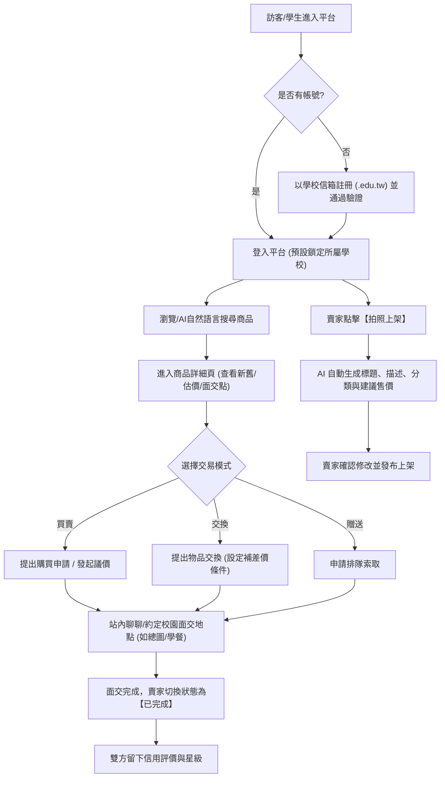

# 產品需求文件 (PRD.md)
## 全國大學生二手物品交換與買賣平台 (UniSwap AI)

> **專案版本**：Vibe Coding 進階整合版 v1.0  
> **更新日期**：2026-11-09  
> **主要架構**：方案 C - AI 智慧驅動整合架構 (AI-First Campus Hub)

---

## 一、產品定位與目標使用者

### 1. 產品定位
專為全臺灣大專院校學生量身打造的**「智慧型校園二手物交換、買賣與贈送平台」**。透過生成式 AI 技術賦能，降低二手商品刊登與定價門檻，並結合大學生專屬的校園身份驗證，建立高信任度、以「同校面交為主、跨校交易為輔」的循環經濟生態圈。

### 2. 目標使用者與痛點分析
| 使用者角色 | 使用情境與痛點 | 解決方案 |
| :--- | :--- | :--- |
| **畢業生 / 搬宿學生** | 課本厚重、二手家電家具體積大，運費高昂且捨不得丟棄。 | 支援零元贈送與校園面交定位，快速出清閒置物資。 |
| **新生 / 在校生** | 原文書與專業工具昂貴，預算有限；擔心詐騙或買到假貨。 | 提供校園信箱認證 (edu.tw)、評價信用機制、面交地標。 |
| **以物易物愛好者** | 手邊有閒置 3C 或教材，想換取其他需要物資，但不願額外掏現金。 | 內建「交換意願」與「補差價」功能。 |
| **怕麻煩的賣家** | 懶得打商品規格、不知道二手行情該賣多少錢。 | **AI 拍照辨識自動生成標題描述**、**AI 合理價格估算**。 |
| **有特定預算的買家** | 翻找分類麻煩，不知道哪個適合自己的需求。 | **AI 購物問答助手**，支援自然語言搜尋。 |

---

## 二、核心業務流程 (Core User Journey)

---

## 三、功能清單與實作範圍規劃

依據作業指引，本專案涵蓋 10 項基礎入門功能、10 項中階功能，以及 4 項 AI 智慧亮點。狀態分為：
- `[已完成]`：核心功能完整實作，包含 UI、互動邏輯與狀態持久化。
- `[模擬實現]`：為配合課堂展示與安全限制（免除外接真實信箱 SMTP 與大型資料庫依賴），提供完備的前端互動體驗與假資料模擬。
- `[未來延伸]`：正式上線商轉時之後續規劃。

### 1. 入門功能 (1 ~ 10)
| 編號 | 功能名稱 | 規格與操作重點 | 實作狀態 |
| :---: | :--- | :--- | :---: |
| 1 | **商品卡片列表** | 顯示照片、名稱、價格、交易標籤與所屬學校。 | `[已完成]` |
| 2 | **商品詳細頁** | 顯示完整描述、新舊程度（9成新等）、交易方式、面交地點與賣家資料。 | `[已完成]` |
| 3 | **商品分類導覽** | 支援課本、電子產品、衣物、家具生活用品等快速膠囊切換。 | `[已完成]` |
| 4 | **關鍵字搜尋** | 即時比對名稱與描述，無搜尋結果時展示友善提示與推薦清單。 | `[已完成]` |
| 5 | **價格範圍篩選** | 最低與最高價格過濾，具備合理性防呆檢查（如最高價不可低於最低價）。 | `[已完成]` |
| 6 | **學校與地區篩選** | 依縣市及大專院校篩選，預設標記「同校面交優先」。 | `[已完成]` |
| 7 | **商品排序機制** | 支援「最新上架」、「價格由低到高」、「價格由高到低」與「同校優先」。 | `[已完成]` |
| 8 | **交易方式標籤** | 明確區分【買賣】、【以物易物】、【免費贈送】，商品可多選。 | `[已完成]` |
| 9 | **收藏清單** | 點選愛心即時加入/取消收藏，使用 LocalStorage 跨頁面保存。 | `[已完成]` |
| 10 | **手機版 RWD 介面** | 針對手機螢幕寬度最佳化，支援底部導覽、觸控滑動卡片與大按鈕點擊。 | `[已完成]` |

### 2. 中階功能 (11 ~ 20)
| 編號 | 功能名稱 | 規格與操作重點 | 實作狀態 |
| :---: | :--- | :--- | :---: |
| 11 | **會員註冊與登入** | 支援帳號登入、登出，提供切換展示帳號機制便於教師評分。 | `[已完成]` |
| 12 | **個人檔案與賣場** | 展示學生暱稱、頭像、所屬學校、個人已上架商品及評價星級。 | `[已完成]` |
| 13 | **商品上架與照片上傳** | 表單包含必填欄位檢查（名稱、分類、價格、新舊、交易方式）。 | `[已完成]` |
| 14 | **商品管理與狀態追蹤** | 賣家可切換【上架中】、【已預約】、【交易完成】或進行【商品下架】。 | `[已完成]` |
| 15 | **交換意願設定** | 填寫希望交換的目標物品（如：想換線性代數），可勾選接受補差價。 | `[已完成]` |
| 16 | **商品公開問答** | 商品頁面設有公開問答區，買家提問、賣家回覆，保護個資不公開。 | `[已完成]` |
| 17 | **交易紀錄與進度** | 獨立頁面檢視「我購買的」、「我賣出的」、「交換中」的歷史與進行中清單。 | `[已完成]` |
| 18 | **站內即時通知** | 模擬新留言、收到出價、狀態更新之通知中心，可一鍵標記已讀。 | `[已完成]` |
| 19 | **檢舉與管理員後台** | 管理員可檢視商品清單、會員清單與違規檢舉案件，可直接下架爭議商品。 | `[已完成]` |
| 20 | **校園身分驗證** | 檢查 Email 結尾是否為 `.edu.tw`；通過後點亮學生驗證標章。 | `[已完成]` |

### 3. AI 智慧功能 (1 ~ 4)
| 編號 | 功能名稱 | 規格與操作重點 | 實作狀態 |
| :---: | :--- | :--- | :---: |
| 21 | **AI 拍照自動上架** | 上傳商品照片後，模擬 AI 多模態辨識出書名/物品名稱、自動填寫分類與描述。 | `[已完成]` |
| 22 | **AI 二手商品價格建議** | 依據品項與新舊程度，顯示「✨ AI 合理估價區間」（清楚標註為估算值）。 | `[已完成]` |
| 23 | **AI 個人化商品推薦** | 依據使用者的瀏覽紀錄、科系偏好，自動在首頁推薦高相關度好物。 | `[已完成]` |
| 24 | **AI 購物問答助手** | 頂部對話式搜尋，支援「找 3000 元以下上課平板」自然語言解析並篩選結果。 | `[已完成]` |

### 4. 萌寵小動物與校園冒險遊戲化系統 (Gamification & Animal Companions) 🎮🐾
| 編號 | 功能名稱 | 規格與操作重點 | 實作狀態 |
| :---: | :--- | :--- | :---: |
| 25 | **校園小動物守護吉祥物 (Campus Animal Mascots)** | 每個學校與分類配有專屬小動物代表（台大黑白汪 🐶、師大文藝貓 🐱、交大工程獺 🦦、成大水豚 🦫、中央松鼠 🐿️），並作為 AI 伴讀管家。 | `[已完成]` |
| 26 | **綠色循環冒險等級 (Eco-EXP & Level System)** | 透過刊登、交換與免費贈送累積綠色冒險經驗值。從「Lv.1 新生小柴」一路晉升至「Lv.10 綠色森林水豚長老」。 | `[已完成]` |
| 27 | **校園成就勳章牆 (Achievement Badges)** | 解鎖趣味成就勳章（如【原文書拯救者】、【零元佛心仙人】、【斷捨離大師】、【面交零遲到】）。 | `[已完成]` |
| 28 | **每日好物幸運盲盒 (Daily Lucky Drop / 淘寶抽卡)** | 每日點擊小動物抽好物盲盒，翻出同校隨機寶藏商品或獲得幸運經驗值加成。 | `[已完成]` |

---

## 四、安全、隱私與合規聲明
1. **個資保護機制**：商品頁面公開問答禁止洩漏手機與住址，面交地點僅標註校園公共地標（如「總圖書館門口」、「學生餐廳」）。
2. **AI 免責宣告**：所有 AI 售價分析與環保減碳數值均標註「✨ 系統估算值，僅供參考」，符合教育部專題規範。
3. **驗證聲明**：校園 Email 驗證僅確保電子信箱網域真實性，平台標註提醒「信箱驗證不等同保證目前在學，面交請留意安全」。

---

## 五、驗收條件與教師評分重現步驟

1. **商品瀏覽與篩選**：點擊首頁分類與價格滑桿，能正確過濾出對應商品；點擊同校面交開關，優先顯示同校商品。
2. **AI 自然語言搜尋**：在首頁輸入「找 3000 元以下二手平板」或點選推薦標籤，列表即時過濾出相符商品。
3. **AI 拍照模擬上架**：進入「刊登商品」，點擊「AI 智慧辨識範例」，自動代入照片、標題、分類與定價建議。
4. **完整交易閉環**：
   - 訪客登入為「台大學生 (陳同學)」。
   - 瀏覽「微積分 Calculus」，提出【申請交換】或【出價購買】。
   - 賣家管理頁面切換狀態為【已預約】 $\rightarrow$ 【交易完成】。
   - 雙方互留評價，星級即時更新於賣家個人檔案。
5. **管理員後台**：點擊切換為管理員視角，可檢視所有檢舉案件並執行下架處置。
