# 介面與使用者體驗設計規範 (UIUX.md)
## 全國大學生二手物品交換與買賣平台 (UniSwap AI)

> **版本**：v1.0 (搭配方案 C - AI 智慧整合風)  
> **更新日期**：2026-11-09

---

## 一、網站導覽架構 (Information Architecture)

```mermaid
graph TD
    Root["全國大學生二手物品交換與買賣平台 (UniSwap AI)"]
    
    Root --> Nav["全域導覽列 (Navbar)"]
    Nav --> SchoolSelector["校園切換器 (我的學校 / 全國跨校)"]
    Nav --> GlobalSearch["AI 自然語言搜尋框"]
    Nav --> QuickPost["📸 AI 拍照上架按鈕"]
    Nav --> Notification["🔔 站內通知中心"]
    Nav --> UserMenu["👤 會員頭像選單"]
    
    Root --> Home["首頁 (Home / AI Hub)"]
    Home --> AIHero["AI 購物助手對話框 & 快捷推薦"]
    Home --> CategoryBar["分類導覽膠囊 (課本/3C/衣物/生活/贈送)"]
    Home --> MultiFilter["複合篩選器 (價格/交易模式/同校優先/排序)"]
    Home --> ProductFeed["商品資訊流 (卡片瀑布流)"]
    
    Root --> ProductDetail["商品詳情頁 (Product Detail)"]
    ProductDetail --> Gallery["多張商品實體圖片輪播"]
    ProductDetail --> ProductMeta["名稱、價格、新舊程度、AI 價格估算標章"]
    ProductDetail --> ExchangeMeta["交換意願設定 (目標物品 & 補差價)"]
    ProductDetail --> CampusMeetup["📍 校園面交建議地點 (附校園地圖標記)"]
    ProductDetail --> SellerCard["賣家資訊卡 (學校系級、EDU 認證、評價星級)"]
    ProductDetail --> PublicQA["公開問答留言板 (防洩漏個資防護)"]
    ProductDetail --> ActionCTA["操作按鈕群 (出價購買 / 申請交換 / 索取贈送 / 收藏)"]
    
    Root --> PostItem["商品發布頁 (Post Item)"]
    PostItem --> AIUpload["AI 拍照辨識上架 (圖片上傳 -> 自動填表)"]
    PostItem --> ManualForm["手動編輯表單 (標題、描述、分類、面交點)"]
    PostItem --> PriceSuggester["AI 定價建議試算"]
    
    Root --> UserCenter["個人中心與賣場 (User Dashboard)"]
    UserCenter --> Profile["學生資料管理 (暱稱、學校信箱認證)"]
    UserCenter --> MyListings["我的刊登與狀態管理 (上架中/已預約/已完成)"]
    UserCenter --> TradeHistory["交易紀錄 (買入/賣出/交換歷史)"]
    UserCenter --> Wishlist["我的收藏與降價追蹤"]
    
    Root --> AdminPanel["管理員後台 (Admin Console)"]
    AdminPanel --> MemberManage["會員狀態審核與名冊"]
    AdminPanel --> ItemManage["商品總表與快速下架處置"]
    AdminPanel --> ReportCenter["爭議與檢舉案件審查處理"]
```

---

## 二、主要畫面與版面佈局 (Key Screens)

### 1. 首頁 (AI-First Campus Hub)
- **頂部 Header**：展示 Logo、學校切換選單（支援 GPS 定位或手動切換）、AI 上架入口與已驗證會員狀態。
- **AI 購物問答助理區**：輸入框預設文字為 *「找 3000 元以下適合上課筆記的 iPad」*，並附上熱門點擊膠囊（*微積分第9版*、*宿舍除濕機*）。
- **分類與條件列**：
  - 分類：`📚 課本教材`、`💻 3C電子`、`👗 服飾配件`、`🛋️ 家具生活`、`🎁 免費贈送`。
  - 交易模式快速過濾：`全部`、`買賣`、`以物易物`、`零元贈送`。
  - 同校面交開關：預設開啟「🏫 優先顯示我的學校」。
- **商品卡片 (Product Card)**：
  - 圖片：1:1 或 4:3 比例，右上角標記交易模式（買賣/交換/贈送），左上角標記「同校面交」。
  - 資訊：品名、價格、新舊程度標籤（如 `9成新`）。
  - 信任徽章：賣家學校與系級、信箱已驗證勾號、面交地標（如 `台大總圖`）。
  - 收藏按鈕：點選愛心切換紅心。

### 2. 商品詳情頁 (Product Detail Page)
- **左側/上方**：多張照片切換預覽。
- **右側/主要資訊**：
  - 標題與標價：大字體，附帶 **「✨ AI 估算合理價格區間」**（附註估算值說明）。
  - 交換需求區塊：若為以物易物，以明顯紫色徽章標示 *「希望交換：線性代數課本（接受補差價 ±$100）」*。
  - 校園安全面交點：顯示建議面交地圖點位與安全須知提醒。
  - 買賣操作列：固定於畫面底部（手機版）或資訊區下方（電腦版），提供【立即購買】、【申請交換】與【聊聊問答】。
- **公開問答區 (Q&A Board)**：
  - 支援匿名或卡稱提問，系統提示「請勿公開留電話、LINE ID 或宿舍房號」。
  - 賣家可針對留言進行回覆。

### 3. 商品刊登與 AI 上架 (Post Item Page)
- **AI 智慧上傳區**：提供相片預覽與「✨ AI 一鍵辨識」按鈕。點擊後透過模擬分析自動填入商品名稱、建議分類、新舊判定與推薦售價。
- **表單驗證**：即時檢查必填項，若價格為 0 則自動切換為【免費贈送】模式。

### 4. 個人中心與管理後台
- **個人賣場**：切換頁籤管理【上架中】、【已預約】、【已售出/已交換】。提供一鍵切換狀態或刪除下架。
- **管理員後台**：簡易表格檢視檢舉紀錄（例如：商品價格不實、涉及違禁品），管理員可點擊【審核通過】或【下架商品】。

---

## 三、設計規範 (Design System & Tokens)

### 0. 萌寵小動物與遊戲化視覺體系 (Animal Mascots & Gamification Visuals) 🐾🎮
- **校園萌寵代表**：
  - 臺灣大學：校園大頭汪 🐶 (`NTU Doggo`) - 活力面交隊長
  - 臺灣師大：文藝橘貓 🐱 (`NTNU Cat`) - 課本知識守護官
  - 清華/陽明交大：極客水獺 🦦 (`Tech Otter`) - 3C 科技鑑價師
  - 成功大學：佛系水豚 🦫 (`NCKU Capybara`) - 環保減碳與零元贈送大使
  - 中央大學：百寶小松鼠 🐿️ (`NCU Squirrel`) - 收藏願望清單管家
- **冒險等級與經驗條 (Eco-EXP Bar)**：
  - 漸層 Emerald/Teal 能量條，即時顯示從「Lv.1 新生小柴」到「Lv.10 森林水豚長老」的成長度。
- **每日好物盲盒 (Lucky Box Modal)**：
  - 可愛小動物開箱動畫，隨機解鎖驚喜二手好物或獲取 +50 減碳點數。
- **成就勳章 (Badges)**：
  - 包含【原文書守護者 📚】、【零元佛心仙人 🎁】、【斷捨離大師 ✨】、【信箱驗證學霸 🎓】。

### 1. 色彩體系 (Color Palette)
| Token 名稱 | 色碼 / Tailwind 類別 | 使用情境 |
| :--- | :--- | :--- |
| **Primary (主色)** | `#4F46E5` (`indigo-600`) | 主按鈕、AI 核心元素、重點標籤、高亮連結 |
| **Primary Light** | `#EEF2FF` (`indigo-50`) | AI 區塊背景、次要標籤襯底 |
| **Exchange (交換色)** | `#9333EA` (`purple-600`) | 以物易物專屬標籤、交換按鈕 |
| **Giveaway (贈送色)**| `#059669` (`emerald-600`) | 免費贈送專屬標籤、環保減碳標章 |
| **Danger / Alert** | `#DC2626` (`rose-600`) | 檢舉按鈕、收藏紅心、錯誤提示 |
| **Warning** | `#D97706` (`amber-600`) | 審查中狀態、面交安全提醒 |
| **Surface Background** | `#F8FAFC` (`slate-50`) | 頁面整體底色 |
| **Card Surface** | `#FFFFFF` (`white`) | 卡片與對話框背景 |
| **Text Primary** | `#0F172A` (`slate-900`) | 主標題、價格與重要文字 |
| **Text Muted** | `#64748B` (`slate-500`) | 次要說明、日期、地點與備註 |
| **Border** | `#E2E8F0` (`slate-200`) | 分隔線、卡片邊框 |

### 2. 字體系統 (Typography)
- **字體家族**：以系統無襯線字體優先：`system-ui, -apple-system, BlinkMacSystemFont, "Segoe UI", Roboto, "Helvetica Neue", sans-serif`
- **字級標準**：
  - H1 頁面大標：`24px (1.5rem)` / `font-bold`
  - H2 模組標題：`18px (1.125rem)` / `font-semibold`
  - H3 卡片標題：`14px (0.875rem)` / `font-semibold`
  - 內文與標籤：`13px ~ 14px` / `font-normal`
  - 輔助說明與次要資訊：最低下限保持 `12px (text-xs)`，禁止使用難以辨識的次微字體。

### 3. 元件尺寸與圓角規範
- **圓角**：卡片統一使用 `rounded-xl (12px)` 或 `rounded-2xl (16px)`，膠囊標籤使用 `rounded-full`。
- **觸控目標**：行動版按鈕最小高度不低於 `44px`，確保手機端單手點擊無障礙。

---

## 四、邊界與狀態處理 (States & Edge Cases)

### 1. 空白狀態 (Empty States)
- **搜尋無結果**：
  - 圖示：顯示放大鏡與問號圖標。
  - 文案：「找不到符合條件的商品！試試放寬篩選範圍，或點擊下方由 AI 為您推薦的熱門好物。」
  - 呼籲行動 (CTA)：提供【重設所有篩選】與【前往刊登此商品願望】按鈕。
- **收藏清單為空**：
  - 文案：「您目前還沒有收藏任何好物，在首頁看見喜歡的物品點擊 ❤️ 即可隨時追蹤！」

### 2. 載入中狀態 (Loading States)
- **骨架屏 (Skeleton Screen)**：在商品列表與詳細頁讀取時，使用漸層閃爍的灰色骨架塊替代旋轉 Spinner，減少使用者等待焦慮感。
- **AI 辨識中**：上傳照片時，顯示「✨ AI 正在分析商品特徵與估算合理價格中...」之進度提示動畫。

### 3. 錯誤與防呆狀態 (Error & Validation States)
- **價格合理性**：篩選器最低價若大於最高價，輸入框邊框轉為紅色並提示「最低價格不可高於最高價格」。
- **學校信箱驗證防呆**：註冊信箱若非以 `.edu.tw` 結尾，即時提示「僅支援全國大專院校 .edu.tw 信箱註冊」。
- **個資防護提示**：公開問答表單若偵測到疑似手機號碼格式（如 09xx-xxx-xxx），跳出安全警語提醒。

---

## 五、響應式斷點 (RWD Breakpoints)
- **手機版 (`< 640px`)**：單欄瀑布流排版、懸浮底部導覽列（首頁、搜尋、拍照上架、通知、我的）、大按鈕操作。
- **平板版 (`640px ~ 1024px`)**：雙欄網格卡片排版。
- **電腦版 (`>= 1024px`)**：三欄至四欄商品網格，左側常駐篩選面板與校園面交熱點地圖。
